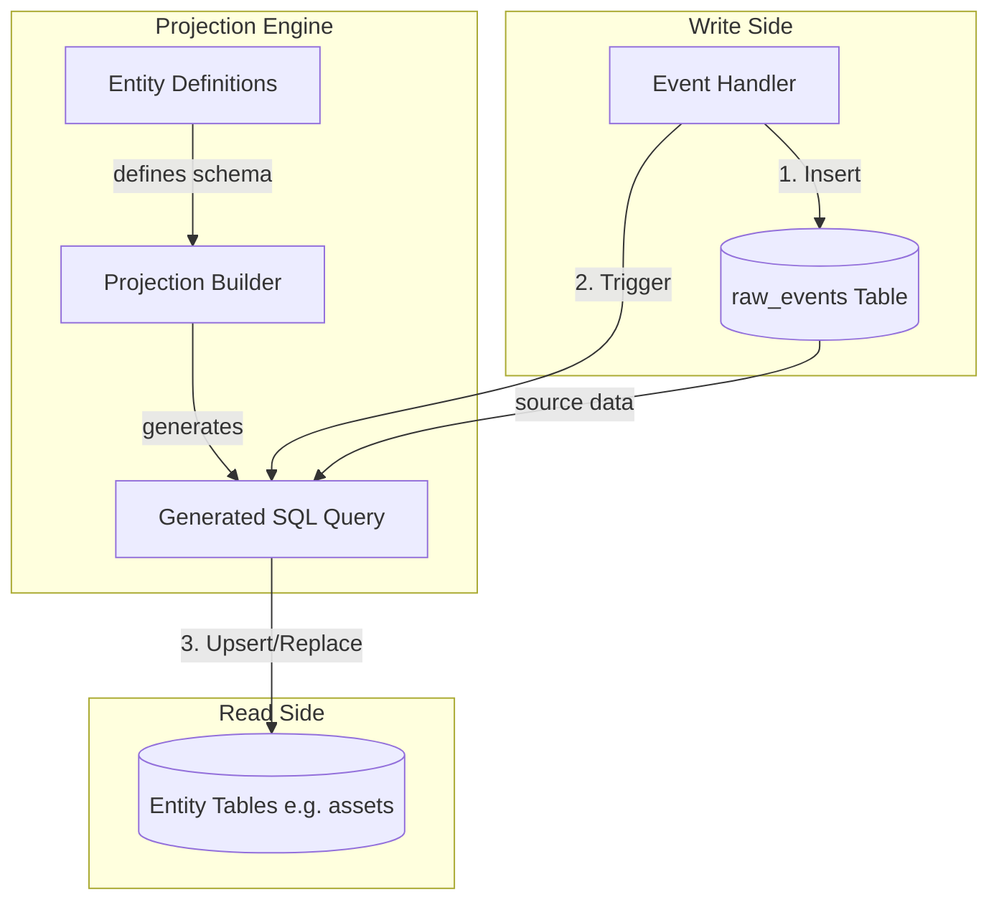

# Event Projection Logic

This document explains the event projection architecture used in the application. It details how raw events are transformed into queryable read models (database tables) using a dynamic SQL generation strategy.

## Overview

The application uses **Event Sourcing** as the source of truth. All state changes are recorded as immutable events in the `raw_events` table. To make this data queryable (e.g., "get all assets"), we "project" these events into standard relational tables (Read Models).

Key characteristics of this implementation:
- **Dynamic SQL Generation**: Projections are not hard-coded. They are generated at runtime based on `Entity Definitions`.
- **SQL-Based Projections**: State reconstruction happens effectively within the database query itself using Common Table Expressions (CTEs) and Window Functions.
- **Tombstone Support**: Events can be "undone" via Tombstone events, which soft-delete the original event from the projection logic without removing history.

## Architecture



## How It Works

### 1. Entity Definitions
The system starts with `packages/contracts/src/event/entity-definitions.ts`. This file defines the schema for each entity (e.g., `asset`, `transaction`).

```typescript
// Example Definition
{
    name: 'asset',
    table: 'assets',
    fields: [
        { name: 'amount', type: 'number', ... }
    ]
}
```

### 2. Projection Builder
The `packages/runtime/src/event/projection-builder.ts` is the core engine. Instead of iterating through events in JavaScript/TypeScript, it builds a massive SQL query that asks the database to reconstruct the state.

When an event is received for an entity (e.g., `ASSET_UPDATED`), the system:
1.  **Deletes** the existing row for that entity in the read model (e.g., `assets` table).
2.  **Executes** a complex INSERT ... SELECT query to rebuild that single row from scratch based on all its history.

### 3. The SQL Strategy (CTEs)
The generated SQL uses a pipeline of Common Table Expressions (CTEs):

1.  **`tombstoned`**: Finds all events that have been "undone" by a `EVENT_TOMBSTONED` event.
2.  **`effective`**: Selects all events from `raw_events` EXCEPT those in the `tombstoned` list.
3.  **`entity_events`**: Filters `effective` events for the specific Entity ID we are updating.
4.  **`w` (Window)**: The magic happens here. It uses Window Functions (`FIRST_VALUE`, `ROW_NUMBER`) to compute the final value logic:
    *   Partitions by Entity ID.
    *   Orders by timestamp descending.
    *   Picks the most recent value for each field from the events whose payload names it: an omitted key leaves the field unchanged, while an explicit `null` clears it.
5.  **`final`**: Selects the top row (latest state).
6.  **`INSERT`**: Puts this final state into the Read Model table.

### 4. Handling Defaults and Casts
The builder automatically handles:
- **Type Casting**: e.g., converting JSON numbers to SQL `REAL`.
- **Defaults**: Applying default values (e.g., `'active'`, `date('now')`) if the event stream produces a NULL.

## Example Lifecycle

1.  **Event Received**: `ASSET_ADDED` (payload: `{id: '1', amount: 100}`)
    *   Projection runs. `assets` table now has row `id='1', amount=100`.
2.  **Event Received**: `ASSET_UPDATED` (payload: `{id: '1', amount: 150}`)
    *   Projection runs. It sees both events. Timestamp order puts `amount: 150` on top. `assets` table updated to `amount=150`.
3.  **Undo (Tombstone)**: User undoes the update. `EVENT_TOMBSTONED` (payload: `{eventId: <id_of_update_event>}`)
    *   Projection runs. The `tombstoned` CTE identifies the update event as invalid. The `effective` CTE excludes it. The logic falls back to the `ASSET_ADDED` event. `assets` table reverts to `amount=100`.

## Key Files
- `packages/contracts/src/event/entity-definitions.ts`: Schema definitions.
- `packages/runtime/src/event/projection-builder.ts`: Logic to generate the projection SQL.
- `packages/runtime/src/event/handlers.ts`: Orchestrates saving to `raw_events` and running projections.
